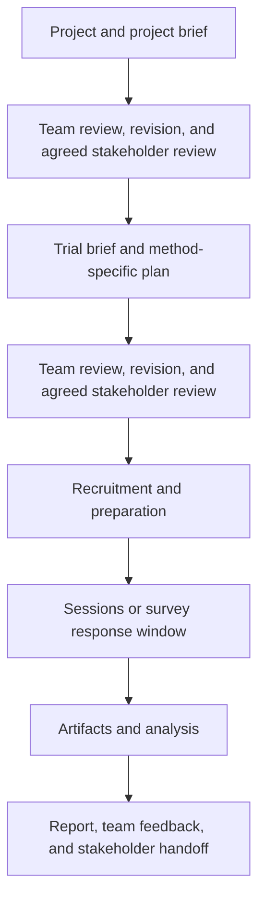

# ResearchOps HackPack
ResearchOps HackPack is a practical toolkit for organizing product, UX, and service-design research. It provides reusable templates and runbooks for setting up projects, coordinating the work, and keeping research materials organized.

I developed it through years of work in federal government contracting, bringing together practices I used and adapted there with my own approaches to organizing research. The toolkit gives individuals and teams a starting structure they can adapt to their tools and ways of working.

## Get Started
You can use the templates yourself or ask a local coding agent to copy and organize them. You supply the research questions, choose the methods, and write the research content. The included skills handle file setup.

### With Your Agent


Copy this prompt into an agent that can read and write local files and run Git. The badge is a visual marker; the prompt below is the starting point.

```text
Help me set up ResearchOps HackPack for my research.

Clone https://github.com/jcklpe/researchOps-hackpack.git into a new local folder. Ask me where to put it if I have not specified a destination. Do not overwrite or remove any existing files. If I already have a checkout, verify it and use it instead of cloning over it.

Read README.md and AGENTS.md in that checkout, then follow skills/setup-research-repo/SKILL.md. Ask me where I want my actual research work to live and prepare that workspace only. Do not create a project, trial, or session yet, and do not fill in research questions or plans.

Show me what is ready, where the blank templates and fictional examples are, and how to request a project next. Do not commit, push, publish, install integrations, or change remotes.
```

The skill files travel with the repository. Your agent can read them directly; no global skill installation or specific agent application is required. If it cannot run Git or access local files, use the manual path and give it access to the downloaded files through your usual tools.

### By Hand
With Git installed, run these commands from the directory where you want the toolkit. Choose a different destination name if `researchOps-hackpack` already exists.

```sh
git clone https://github.com/jcklpe/researchOps-hackpack.git
cd researchOps-hackpack
mkdir -p research
```

Open the folder in your editor. Markdown files are plain text; you can also copy their content into your preferred document tool. Without terminal access, use GitHub's **Code → Download ZIP** option or copy just the templates you need. No tracker or integration is required.

`research/` is a suggested local working folder and is ignored by Git in this toolkit. You can choose a different location, including a separate private repository. Keep actual research materials in storage appropriate to their audience; this kit's public repository is not a destination for participant data.

## Your First Project and Trial
1. Copy [project-brief.md](templates/project-brief.md) into a new project folder in your working location. Fill it in with your research purpose and context.
2. When you are ready for a particular round of research, create a trial folder inside that project. Copy [trial-brief.md](templates/trial-brief.md), [trial-report.md](templates/trial-report.md), and the plan for your chosen method: [interview](templates/trial-plan-interview.md), [survey](templates/trial-plan-survey.md), or [user testing](templates/trial-plan-user-testing.md). Create an `artifacts/` folder there. In the trial brief, link to the project's brief.
3. For an interview or user-test session, create `artifacts/session-01/` and copy [field-notes.md](templates/field-notes.md) there. Link it to the trial plan. Each observer can keep a separate notes file. Surveys can keep an export at the trial's artifact level instead.

With an agent, request these as separate operations, supplying names, destinations, and your chosen method:

```text
Use skills/create-research-project/SKILL.md to create a project called community-support in my research workspace. Leave the research content blank.
```

```text
Use skills/create-research-trial/SKILL.md to create an interview trial called interviews inside community-support. Leave the research content blank.
```

```text
Use skills/create-research-session/SKILL.md to create session-01 in that interview trial, with a blank field-notes.md.
```

You can request survey or user-testing trials the same way. Workspace setup does not run these creation operations automatically. Examples contain invented answers; always copy blank templates for actual work.

## How the Pieces Fit
- **Project:** the research problem or area of inquiry. It can concern a product, several services, a platform, or something else entirely.
- **Trial:** one bounded round of research within a project, with its own brief, plan, collected material, and report. Multiple trials can use different methods; no particular sequence is required.
- **Artifacts:** the underlying material, such as field notes, transcripts, recordings, and survey exports. Sessions group material from one interview or user test. A survey does not need a folder per response. See [research artifacts](guides/research-artifacts.md).

```text
templates/                  Blank documents to copy
  runbooks/                 Portable workflow templates
    tasks/                  Instructions and completion criteria for each task
examples/community-support/ Fictional project with three worked trials
  interviews/               Brief, plan, report, and session field notes
  survey/                   Brief, plan, report, and invented response data
  user-testing/             Brief, plan, report, and session field notes
guides/                     Guidance on arranging collected materials
skills/                     Mechanical workspace, project, trial, and session setup
.github/ISSUE_TEMPLATE/     GitHub implementation of the portable runbooks
```

Browse the [fictional project](examples/community-support/project-brief.md), then compare its [interview](examples/community-support/interviews/trial-brief.md), [survey](examples/community-support/survey/trial-brief.md), and [user-testing](examples/community-support/user-testing/trial-brief.md) trials. Each example document links back to its blank template. These are illustrations, not completed research or a required three-trial program.

## Coordinate the Work
Use the [project runbook](templates/runbooks/project-runbook.md) to establish the project and its brief, then the [trial runbook](templates/runbooks/trial-runbook.md) to organize planning, recruitment, data collection, and reporting. The task definitions preserve owners, review, revision, and handoffs.

Markdown describes the workflow. Put actual assignments and status in the team's chosen tracker or working system, whether that is GitHub, Jira, Trello, Asana, a document, or something else. Adapt the definitions manually; the kit does not currently automate those transfers. The [GitHub issue forms](.github/ISSUE_TEMPLATE/) show one implementation and can be used in your own GitHub repository with Issues enabled.



Templates are prompts, not mandatory forms. Keep the review responsibilities and evidence links meaningful for your work. Existing [synthesis-method ideas](synthesis-methods.md) are available as additional reference; selecting and carrying out an analysis remains the researcher's responsibility.
